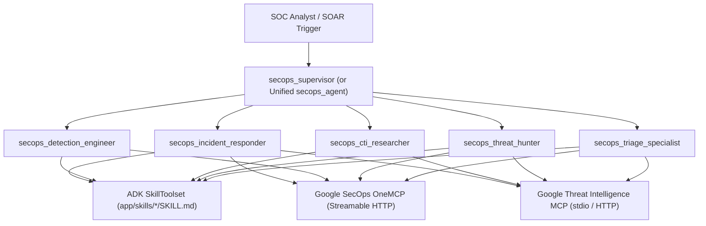

# Google SecOps Custom Agents (OneMCP + Skills + Personas + GTI MCP)

This recipe provides a canonical Google Agent Development Kit (ADK) architecture for autonomous Security Operations Center (SOC) workflows. It integrates four core pillars:

1. **Google SecOps OneMCP (`secops_*`)**: Connects to the remote Google Security Operations Model Context Protocol endpoint (`https://chronicle.<region>.rep.googleapis.com/mcp`) over Streamable HTTP using Google Application Default Credentials (ADC) or Agent Engine OAuth pass-through. It filters out the 7 high-bloat feed-management tools (`create_feed`, `update_feed`, `run_parser`, `list_feeds`, `get_feed`, `disable_feed`, `enable_feed`), cutting eager `inputSchema` payload size by 68.94%, and strips `response_json_schema` via `before_model_callback`.
2. **Google Threat Intelligence MCP (`gti_*`)**: Connects to the GTI MCP server (`uvx gti-mcp` over stdio or remote Streamable HTTP via `GTI_MCP_URL`) for campaign collection profiling, multi-hop indicator pivoting, and code-signing verification (`VALID_CERTIFICATE`) to prevent signed OS LOLBin overcontainment.
3. **Progressive Skill Disclosure (`SkillToolset`)**: Bundles 6 curated SecOps operational `SKILL.md` runbooks (`triage-alerts`, `suspicious-login-triage`, `malware-triage`, `gti-collection-threat-hunt`, `detection-rule-validation-tuning`, and `ioc-containment`) loaded on demand with `google.adk.skills.load_skill_from_dir`.
4. **Adaptive Specialist Personas (`SECOPS_USE_PERSONAS`)**:
   - **Persona Hierarchy (`SECOPS_USE_PERSONAS=true`, default)**: Root `secops_supervisor` coordinates 5 role-scoped specialist sub-agents (`secops_triage_specialist`, `secops_threat_hunter`, `secops_cti_researcher`, `secops_detection_engineer`, and `secops_incident_responder`), each with its own Markdown persona instruction overlay (`app/profiles/*.md`), scoped `SkillToolset`, and role-filtered SecOps OneMCP and GTI MCP toolsets.
   - **Unified Frontier Agent (`SECOPS_USE_PERSONAS=false`)**: Single `secops_agent` equipped with the full 6-skill `SkillToolset` and live SecOps OneMCP and GTI MCP toolsets.

## Architecture



## Setup

1. Navigate to the recipe directory and install dependencies using `uv`:

```bash
cd contrib/python/secops-custom-agents
uv sync
```

2. Copy `.env.example` to `.env` and populate your Google Cloud project, Google SecOps tenant (`CHRONICLE_PROJECT_ID`, `CHRONICLE_CUSTOMER_ID`, `CHRONICLE_REGION`), and Google Threat Intelligence API key (`VT_APIKEY`):

```bash
cp .env.example .env
```

3. Authenticate with Google Cloud Application Default Credentials so the SecOps OneMCP `header_provider` can mint Bearer tokens with `https://www.googleapis.com/auth/cloud-platform` scope:

```bash
gcloud auth login --update-adc
```

## Run

Run the interactive ADK CLI or web playground from the recipe root:

```bash
# Run the interactive CLI session (defaults to SECOPS_USE_PERSONAS=true)
uv run adk run app

# Or launch the ADK web UI
uv run adk web

# Or switch to the unified single-agent frontier topology
SECOPS_USE_PERSONAS=false uv run adk run app
```

## Run Unit Tests

Unit tests validate agent hierarchy construction, unified frontier mode, progressive `SkillToolset` loading, OneMCP feed-tool filtering, `response_json_schema` stripping, and credential validation without requiring a `.env` file or live network calls:

```bash
uv run pytest
```
